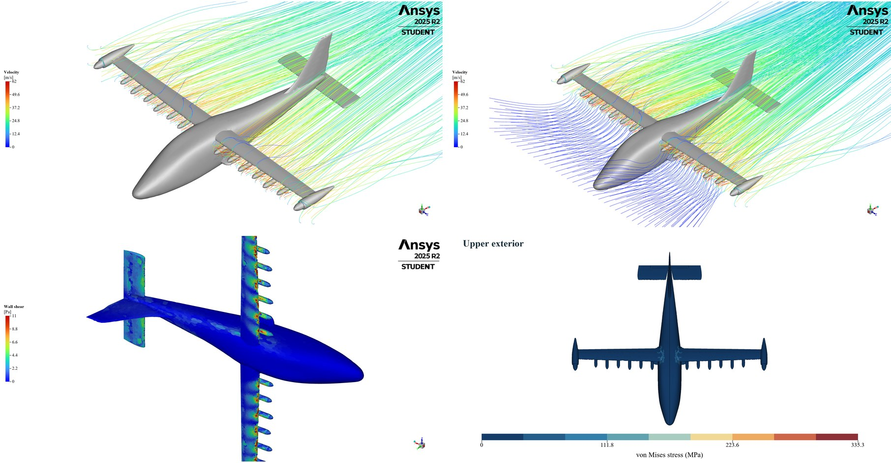
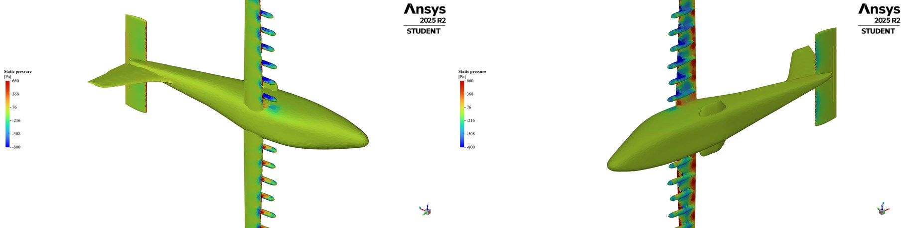
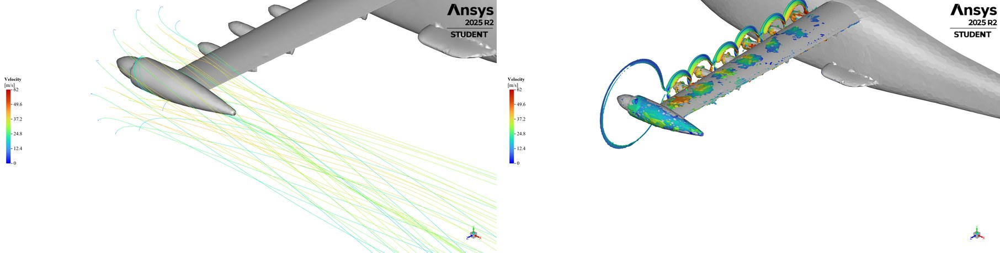
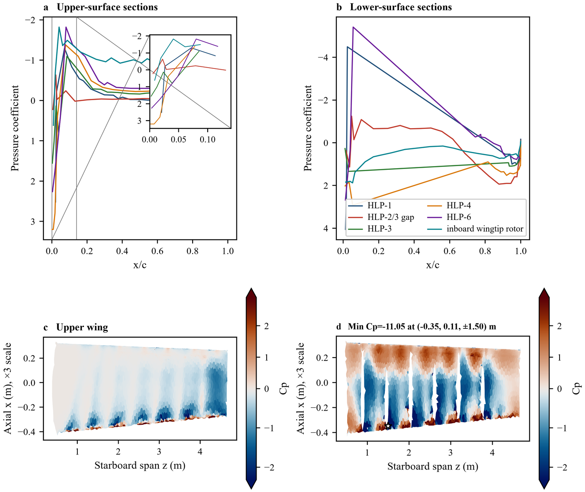
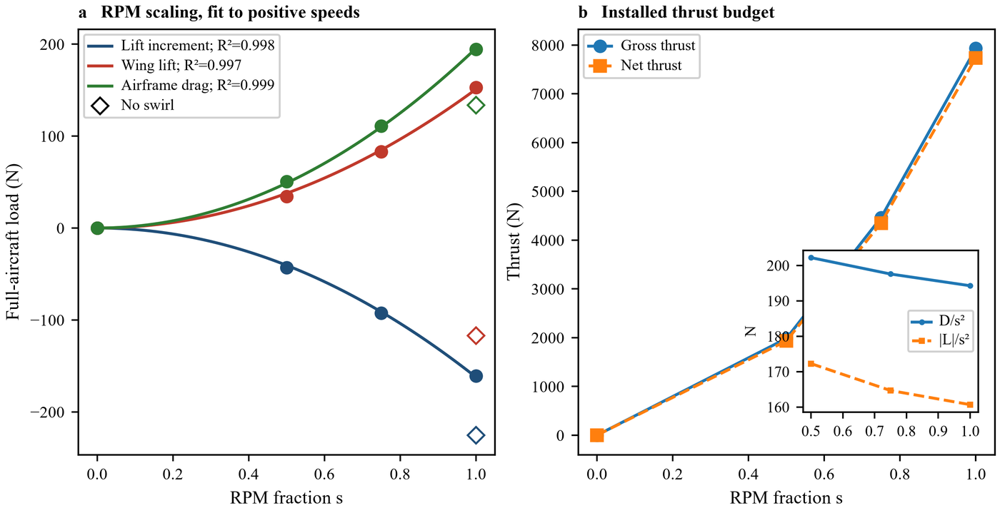
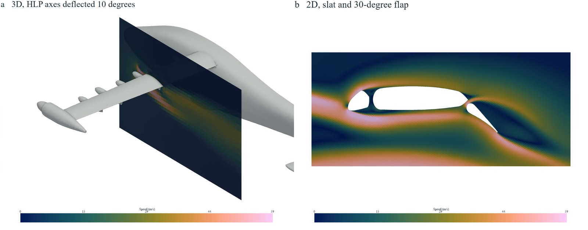
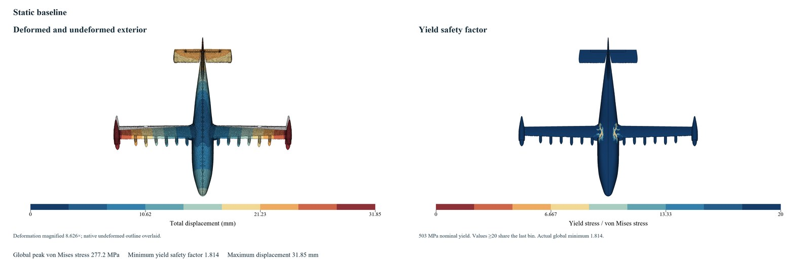
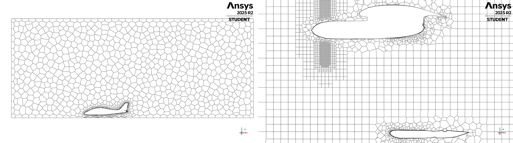
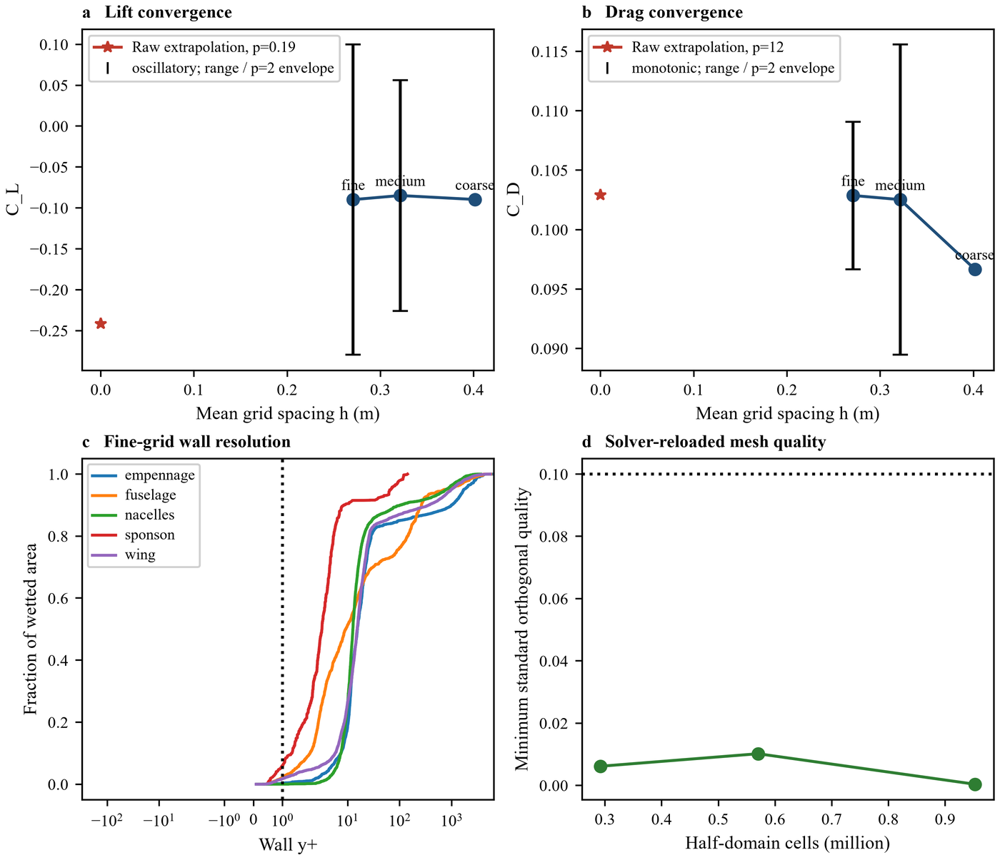

<div align="center">

# External Aerodynamics and One-Way Structural Response of a Distributed-Electric-Propulsion Aircraft at the Start of Taxiing

**Yuang Zhou** · University of Dundee

[-b31b1b.svg)](#citation)




<sub><b>Fine-grid solution at 100 % propeller speed</b> (native Ansys Fluent / MAPDL views, mirrored half model).
Top: propeller-slipstream pathlines and velocity streamlines (0–62 m/s). Bottom: wall shear stress (0–11 Pa) and skin
von Mises stress of the carry-through wing-box model on the 0–335 MPa allowable scale.</sub>

</div>

---

## Abstract

A three-dimensional, steady RANS analysis of a high-wing distributed-electric-propulsion (DEP) aircraft with the
layout of NASA's X-57 Maxwell is performed in Ansys Fluent 2025 R2 for the start of taxiing at sea level
(V<sub>∞</sub> ≈ 0). Twelve high-lift propellers (5,400 rpm) and two wingtip propellers (2,700 rpm) are represented by
calibrated swirling actuator disks on a symmetric half model. The fine grid gives a gross take-off thrust of
**7.93 kN** and a net forward force of **7.74 kN**. The slipstream lifts the wing by **+153 N**, but the nacelles
(−215 N) and the empennage (−99 N) carry download, so the net aerodynamic force on the airframe is −170 N. The highest
suction on the wing, **C<sub>p</sub> = −11.05**, occurs on the lower leading edge at 31 % semi-span, directly behind
the second high-lift propeller. All propeller-induced loads scale with the square of the rotational speed
(R² ≥ 0.997), and slipstream swirl contributes 270 N of wing lift. A 30° slotted flap in the blown slipstream gives
the largest section lift increment (Δc<sub>l</sub> = +1.13). A one-way fluid–structure analysis with a wing box
carried through the fuselage keeps **98.6 %** of the skin in the lowest stress band with a minimum yield safety factor
of **1.81**. The verification gaps are reported openly (see [Verification status](#verification-status)).

## Key results

| Quantity (full aircraft, fine grid, level frame) | Value |
|---|---:|
| Gross take-off thrust *T*<sub>gross</sub> (12 HLPs + 2 wingtip propellers) | 7,931.5 N |
| Slipstream-induced airframe drag *D* (pressure 148 N + viscous 46 N) | 194.9 N |
| Net take-off thrust *T*<sub>net</sub> = *T*<sub>gross</sub> − *D* | **7,736.6 N** |
| Static lift increment of the blown wing Δ*L*<sub>wing</sub> | **+153.3 N** |
| Airframe lift Δ*L*<sub>air</sub> (nacelles −215 N, empennage −99 N) | −170.2 N |
| Peak suction *C*<sub>p,min</sub> (lower leading edge behind HLP-2) | −11.05 |
| Lift / drag scaling with propeller speed, *F* = *k s*² | R² = 0.998 / 0.997 / 0.999 |
| Swirl contribution to wing lift (swirl on − off) | +270 N |
| Best 2D high-lift section in the slipstream (30° slotted flap) | Δ*c*<sub>l</sub> = +1.13 |
| Skin area in the lowest stress band / minimum yield safety factor | 98.6 % / 1.81 |

<table>
<tr>
<td width="50%"><br><sub>Static gauge pressure on the upper and lower surfaces (−800 to 660 Pa).</sub></td>
<td width="50%"><br><sub>Wingtip-propeller slipstream / tip vortex and Q = 3.1×10⁵ s⁻² iso-surface.</sub></td>
</tr>
<tr>
<td width="50%"><br><sub>Wing C<sub>p</sub> sections and surface maps; the star marks the global minimum.</sub></td>
<td width="50%"><br><sub>Every propeller-induced load follows k s² (s = n/n<sub>nom</sub>); diamonds: swirl-free case.</sub></td>
</tr>
<tr>
<td width="50%"><br><sub>Design modifications: 10° HLP thrust vectoring (3D) and slat + 30° slotted flap (2D) in the extracted slipstream.</sub></td>
<td width="50%"><br><sub>One-way FSI (MAPDL SHELL181): deformed shape (×8.6) and yield safety factor, minimum 1.81.</sub></td>
</tr>
</table>

## Method

| Item | Setting |
|---|---|
| Geometry | Supplied CAD (inches, 5.41° nose-up) scaled to metres and de-rotated; blades replaced by actuator disks; half model with a symmetry plane |
| Domain and boundaries | *x* ∈ [−18, 30] m, *y* ∈ [−1.70, 18] m, *z* ∈ [0, 20] m; zero-gauge total-pressure inlets (upstream/top/side), pressure outlet, no-slip runway |
| Mesh | Fluent Meshing Poly-Hexcore: hexahedral far field, polyhedral transition, prism inflation; coarse / medium / fine = 0.29 / 0.57 / 0.95 M half-model cells |
| Solver | Pressure-based coupled, pseudo-transient, second order; SST *k*–ω with curvature correction and production limiter; ideal gas, ρ = 1.225 kg/m³ |
| Propellers | 14 swirling actuator disks, thrust ∝ r̂√(1−r̂); HLP loads from NASA fixed-mode tables, wingtip loads from BEMT trimmed to 127.5 N m; discrete calibration error 2×10⁻¹⁴ |
| Studies | Grid triplet with Celik/ASME V&V 20 GCI, 0/50/75/100 % speed sweep, swirl on/off, propulsion decomposition, alternating rotation, ground boundary, 10 m/s rolling start, realizable *k*–ε, 2D high-lift sections, 3D thrust vectoring |
| Structure | Fine-grid wall pressure and shear mapped onto MAPDL SHELL181 skins (7075-T6, 1.8–3.5 mm), spars, ribs and a carry-through wing box; three shell meshes |

<p align="center"><br>
<sub>Fine Poly-Hexcore mesh: symmetry-plane faces of the domain and the hexahedral core with disk refinement.</sub></p>

## Verification status

The Ansys Student licence caps the mesh at 1,048,576 cells. Within that limit the following targets were met or
missed; the paper reports every item.

| Check | Target | Result | Status |
|---|---|---|:---:|
| Actuator-disk thrust/torque calibration | machine precision | 2×10⁻¹⁴ on every grid | ✅ |
| Force steadiness (last 200 iterations) | < 0.5 % | 0.07–0.43 % | ✅ |
| Drag grid convergence (fine-grid uncertainty) | < 5 % | 6.0 % (monotonic) | ❌ |
| Airframe-lift grid convergence | monotonic | oscillatory, −165.4 ± 4.8 N across the triplet | ❌ |
| Surface-mesh refinement | refined surface solved | six refined grids meshed or attempted, all rejected (degenerate junction cell) | ❌ |
| Wall resolution | *y*⁺ ≈ 1 | wing area-weighted mean 142 (face median 15) | ❌ |
| Specific-dissipation-rate residual | < 5×10⁻⁴ | plateau 1–3×10⁻³ (junction cells) | ❌ |
| Skin area in the lowest von Mises band | ≥ 95 % | 98.6 % | ✅ |
| Minimum yield safety factor | ≥ 1.5 | 1.81 | ✅ |
| Shell-mesh uncertainty (p99 stress / tip deflection) | < 10 % | 7.6 % / 7.1 % | ✅ |

<p align="center"></p>

## Repository layout

```text
REPORT/                 LaTeX source of the paper (main.tex, x57_paper.sty, references.bib)
  build_report.ps1      XeLaTeX build of the coursework PDF
  build_arxiv.py        pdfLaTeX build of the arXiv bundle (REPORT/arxiv/, not versioned)
  prepare_report_assets.py  crops / splits native renders for the page layout (pixels unchanged)
scripts/                geometry preparation, meshing, Fluent/MAPDL drivers, post-processing and plotting
SUPERVISOR/             unattended run orchestration (fast-track pipeline, surface-refinement study)
DELIVERABLES/data/      processed results: forces, GCI, convergence QA, y+, C_p sections, FSI tables
docs/                   README figures (make_readme_figures.py)
skills/                 workflow notes for each stage (geometry, CFD, verification, FSI, visualisation)
```

Meshes, Fluent case/data files, native renders and logs are kept out of version control because of their size
(the fine-grid case and data alone are about 400 MB).

## Reproducing

Requirements: Windows, Ansys 2025 R2 (Fluent, Fluent Meshing, Mechanical APDL; the Student edition was used),
Python 3.13 with NumPy, SciPy, Matplotlib, h5py, pandas, PyVista/VTK, Pillow and PyMuPDF, and a TeX distribution
(MiKTeX or TeX Live) with XeLaTeX and pdfLaTeX.

```powershell
# full pipeline (meshing -> solves -> post-processing -> packaging), unattended and resumable
.\00_FASTTRACK_START.ps1

# paper: coursework PDF (XeLaTeX) and arXiv bundle (pdfLaTeX + bundled .bbl)
python REPORT\prepare_report_assets.py
powershell -File REPORT\build_report.ps1
python REPORT\build_arxiv.py
```

Every number in the paper is read from the converged Fluent and MAPDL outputs (`DELIVERABLES/data`); nothing is
hand-entered or tuned.

## Citation

```bibtex
@misc{zhou2026x57dep,
  title  = {External Aerodynamics and One-Way Structural Response of a Distributed-Electric-Propulsion
            Aircraft at the Start of Taxiing},
  author = {Zhou, Yuang},
  year   = {2026},
  note   = {University of Dundee. arXiv preprint, identifier to be added}
}
```

## Acknowledgements

Prepared within the module DI41015 Computer Aided Engineering I at the University of Dundee. The aircraft geometry
was supplied with the module brief; the propeller data come from NASA's published X-57 high-lift and cruise propeller
reports. Native views carry the Ansys Student watermark of the software used.
